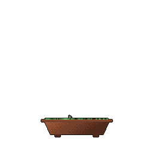

<!-- Header banner -->
<p align="center">
  
</p>

<p align="center">
  <a href="https://saurabhnair.com"></a>
</p>

<p align="center">
  <a href="https://saurabhnair.com"></a>
  <a href="https://www.linkedin.com/in/saurabhnair13113"></a>
  <a href="https://saurabhnair.com/assets/resume.pdf"></a>
  <a href="mailto:saurabhnair13113@gmail.com"></a>
  <a href="https://instagram.com/saurabh_13113"></a>
</p>

> [!TIP]
> **🟢 Open to new-grad SWE roles (2027).** CS + Econ @ UofT, ex-Bayer software developer intern, and a TA for 150+ students. [Grab my resume](https://saurabhnair.com/assets/resume.pdf) or [say hi](mailto:saurabhnair13113@gmail.com).

<p align="center">
  
</p>

---

## 👋 About me


Software developer from Abu Dhabi 🇦🇪, now studying **Computer Science + Economics** at the **University of Toronto** 🇨🇦 (grad June 2027). I like building products that sit at the edge of AI and real usability, and I've lived in over 5 countries along the way.

<br clear="right" />

| | |
|---|---|
| 🚀 **Building** | GenAI tools (ClinicEar), hackathon projects, full-stack apps |
| 🌱 **Leveling up** | React/Next.js, FastAPI, Swift |
| 💬 **Ask me about** | Python, JavaScript/TypeScript, MySQL, GenAI/LLM apps |
| 🎓 **Teaching** | TA @ UofT: CSC236, CSC263, ECO225 (150+ students) |
| 🏆 **Organizing** | Led **DeerHacks**, a 500+ participant student hackathon at UTM |
| 💼 **Looking for** | New-grad SWE roles (2027) |

<details>
<summary><b>💼 Experience at a glance</b></summary>
<br>

| When | Role | Highlights |
|---|---|---|
| May 2025 – Aug 2026 | **Software Developer Intern**, Bayer Canada | Radimetrics dose-management platform: exam-level alert filtering (**+28%** accuracy), Jenkins/AWS OS patch pipeline (**−35%** release prep), RHEL/Alma dependency upgrades (**−20%** post-release defects) |
| Sep 2024 – May 2025 | **Software Engineering Intern**, Kaytoons Inc. | Backend for a children's learning app; PlayHT voice cloning in Python (**+18%** session duration) |
| Sep 2024 – Present | **Teaching Assistant**, University of Toronto | Grading, office hours, and support for 150+ students |
| Jun – Aug 2024 | **ML Intern**, Emirates Steel Arkan | Predictive maintenance on sensor data (**−15%** unplanned downtime), real-time consumption dashboard |

</details>

---

## ⭐ Featured projects

<table>
  <tr>
    <td width="50%" valign="top">
      <h3>🧠 <a href="https://github.com/saurabh13113/feynomenon-chatbot">Feynomenon</a> 🏆</h3>
      <b>Winner, TMU Solution Hacks '25.</b> Adaptive AI tutor built on the Feynman technique, with Gemini-generated responses and session analytics.<br><br>
      
      
      
      
      <br><br>
      <a href="https://feynomenon-chatbot.vercel.app/">Live demo</a> · <a href="https://github.com/saurabh13113/feynomenon-chatbot">Code</a>
    </td>
    <td width="50%" valign="top">
      <h3>🩺 <a href="https://github.com/saurabh13113/ClinicEar-GenAI2026">ClinicEar</a></h3>
      AI clinical note generator: listens to doctor-patient consultations in real time and drafts a structured SOAP note with ICD-10 suggestions and documentation-gap flags. Built for GenAI Genesis 2026 (Sun Life + IBM tracks).<br><br>
      
      
      
      
      <br><br>
      <a href="https://frontend-delta-ochre-79.vercel.app">Live demo</a> · <a href="https://github.com/saurabh13113/ClinicEar-GenAI2026">Code</a>
    </td>
  </tr>
  <tr>
    <td width="50%" valign="top">
      <h3>➗ <a href="https://math-chatbot-eta.vercel.app/">Math Chat Bot</a></h3>
      Llama-powered chatbot that helps students work through math problems.<br><br>
      
      
      <br><br>
      <a href="https://math-chatbot-eta.vercel.app/">Live demo</a> · <a href="https://github.com/saurabh13113/math-chatbot">Code</a>
    </td>
    <td width="50%" valign="top">
      <h3>📈 <a href="https://github.com/saurabh13113/ml-stock-price-predictor">ML Stock Price Predictor</a></h3>
      scikit-learn + pandas model over S&amp;P 500 data to predict next-day prices.<br><br>
      
      
      <br><br>
      <a href="https://github.com/saurabh13113/ml-stock-price-predictor">Code</a>
    </td>
  </tr>
  <tr>
    <td width="50%" valign="top">
      <h3>🚢 <a href="https://github.com/saurabh13113/battleship-solitaire-solver">Battleship Solitaire Solver</a></h3>
      Constraint-satisfaction + GAC solver for Battleship Solitaire.<br><br>
      <br><br>
      <a href="https://github.com/saurabh13113/battleship-solitaire-solver">Code</a>
    </td>
    <td width="50%" valign="top">
      <h3>🥫 <a href="https://pantry-app-lac.vercel.app/">Pantry Tracker</a></h3>
      Pantry management app with Next.js, Material UI and Firebase.<br><br>
      
      <br><br>
      <a href="https://pantry-app-lac.vercel.app/">Live demo</a> · <a href="https://github.com/saurabh13113/pantry-app">Code</a>
    </td>
  </tr>
</table>

<p align="center">
  <a href="https://saurabhnair.com/projects"><b>See all projects on saurabhnair.com →</b></a>
</p>

---

## 🛠️ Tech stack

<p align="center">
  <br>
  
</p>

---

## 📊 GitHub stats

<!-- STATS:START -->
| 📦 Public repos | ⭐ Stars earned | 👥 Followers | 📅 On GitHub since |
|:-:|:-:|:-:|:-:|
| 31 | 6 | 10 | 2022 |

```text
JavaScript        █████████░░░░░░░░░░░   46.4%
Python            ████░░░░░░░░░░░░░░░░   21.1%
Jupyter Notebook  ██░░░░░░░░░░░░░░░░░░   10.3%
TypeScript        ██░░░░░░░░░░░░░░░░░░   10.3%
Java              █░░░░░░░░░░░░░░░░░░░    5.2%
C                 ░░░░░░░░░░░░░░░░░░░░    2.5%
```
<!-- STATS:END -->

---

## 🐱 Pet my pixel cat

<!-- PET:START -->
<p align="center">
  <a href="https://github.com/saurabh13113/saurabh13113/issues/new?title=pet-me&body=Just%20petting%20the%20cat%20%F0%9F%90%B1.%20There%27s%20nothing%20to%20write%3A%20click%20%E2%80%9CSubmit%20new%20issue%E2%80%9D%20and%20the%20bot%20does%20the%20rest."></a><br>
  <b>Pixel is chilling</b> · petted <b>0</b> times<br>
  <sub>👆 Click the cat to pet it. It opens a pre-filled issue (you need to be signed in to GitHub) and a bot does the rest.</sub>
</p>
<!-- PET:END -->

---

## 🌳 My bonsai

<p align="center">
  <br>
  <sub>Grown from my GitHub history with <a href="https://github.com/egorthinks/git-bonsai">git-bonsai</a>: streaks add blossoms, long gaps leave deadwood.</sub>
</p>

---

## 🐍 Contribution snake

<p align="center">
  <picture>
    <source media="(prefers-color-scheme: dark)" srcset="https://raw.githubusercontent.com/saurabh13113/saurabh13113/output/github-contribution-grid-snake-dark.svg" />
    <source media="(prefers-color-scheme: light)" srcset="https://raw.githubusercontent.com/saurabh13113/saurabh13113/output/github-contribution-grid-snake.svg" />
    
  </picture>
</p>

---

## ⚡ Recently shipped <sub>(auto-updated)</sub>

<!-- RECENT_REPOS:START -->
| Repo | What it is | Lang | Updated |
|---|---|---|---|
| [neetcode-submissions](https://github.com/saurabh13113/neetcode-submissions) | My NeetCode.io problem submissions | Python | 16d ago |
| [pantry-app](https://github.com/saurabh13113/pantry-app) | Summer Project that uses FireBase, React and Next.js to build a simple pantry tracker app. | JavaScript | 238d ago |
| [math-chatbot](https://github.com/saurabh13113/math-chatbot) | Summer Project that uses Meta Llama to build an AI chatbot to help students out on a math website that helps with math problems and practice math using next.js, react, vercel. | JavaScript | 238d ago |
| [ECO225_Tutorial1_2026](https://github.com/saurabh13113/ECO225_Tutorial1_2026) | Tutorial 1 for ECO225 | — | 298d ago |
| [battleship-solitaire-solver](https://github.com/saurabh13113/battleship-solitaire-solver) | University project that solves Battleship solitaire game using Constraint Satisfaction and GAC. | Python | 678d ago |
<!-- RECENT_REPOS:END -->

## 🕒 Latest activity <sub>(auto-updated)</sub>

<!-- ACTIVITY:START -->
- ⬆️ Pushed 9 commits to [neetcode-submissions](https://github.com/saurabh13113/neetcode-submissions) · <sub>16d ago</sub>
<!-- ACTIVITY:END -->

---

<p align="center">
  <br>
  <sub>🎮 Peek into my <a href="https://saurabhnair.com">pixel-art 3D room</a>, there's a penalty shootout on the PS4.</sub>
</p>
